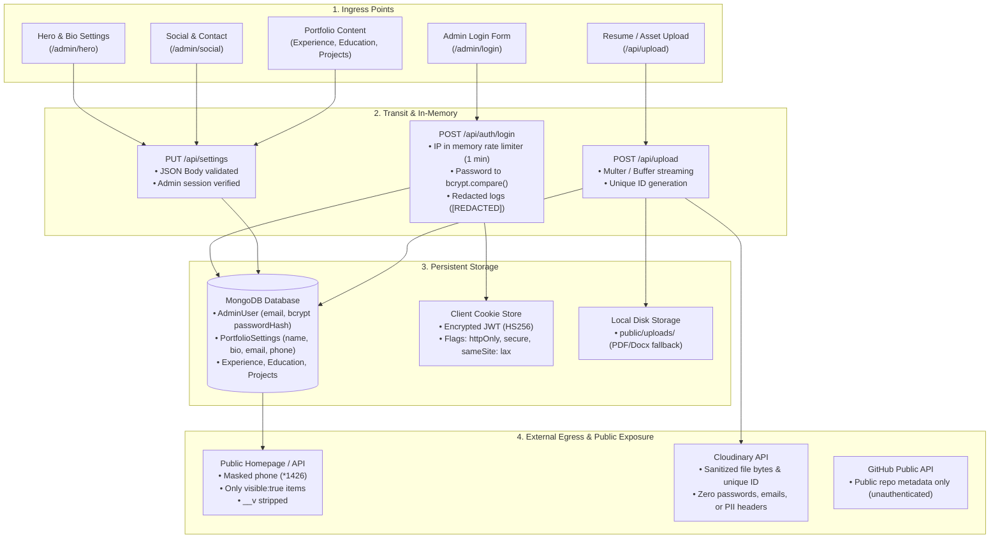

# Personal Data Flow & Privacy Audit (Bearer Standard)

*Audit conducted in accordance with [Bearer](https://github.com/bearer/bearer) data security and privacy guidelines.*

---

## Executive Summary

| Category | Status | Details |
| :--- | :--- | :--- |
| **Data Collection Mapping** | **Complete** | All ingress points mapped to transit, storage, and egress. |
| **Log Sanitization** | **Protected** | Zero personal data or tokens in logs; auth logs strictly use `[REDACTED]`. |
| **Third-Party Services** | **Audited** | Cloudinary, MongoDB, Resend (idle), Gemini (idle). No PII over-exposure. |
| **Password Handling** | **Compliant** | Passwords hashed with salted bcrypt (cost 10). Plaintext never stored or returned. |
| **Cookies & Web Storage** | **Hardened** | `httpOnly`, `secure`, `sameSite: lax`. Zero PII in `localStorage`/`sessionStorage`. |
| **API Response Filtering**| **Hardened** | Mongoose `__v` stripped. Non-admin queries enforce `visible: true` and phone masking. |
| **Data Deletion (GDPR)**   | **Implemented** | `DELETE /api/auth/account` + Admin UI Danger Zone permanently deletes & anonymizes data. |

---

## 1. Personal Data Flow Map

---

## 2. Ingress & Egress Data Inventory

| Field | Ingress Point | Internal Path | Persistent Storage | External Destination / Egress | Access Restrictions |
| :--- | :--- | :--- | :--- | :--- | :--- |
| **Email (Admin)** | `/admin/login` | Body ➔ `normalizedEmail` | `AdminUser.email` | Encrypted JWT cookie payload | Admin only |
| **Password** | `/admin/login` | Body ➔ `normalizedPassword` ➔ `bcrypt.compare` | **Never stored** (bcrypt hash only) | **Never leaves server** | Local variable only |
| **IP Address** | `x-forwarded-for` | In-memory `rateLimitStore` | **None** (cleared after 1 min window) | None | Server memory only |
| **Name & Bio** | `/admin/hero` | Body ➔ `PUT /api/settings` | `PortfolioSettings.hero` | Public Portfolio Homepage | Public |
| **Email (Contact)**| `/admin/social` | Body ➔ `PUT /api/settings` | `PortfolioSettings.social.email` | Public Contact Section | Public |
| **Phone Number** | `/admin/social` | Body ➔ `PUT /api/settings` | `PortfolioSettings.social.phone` | Masked in `GET /api/settings` (`*******1426`) | Unauthenticated calls receive masked value |
| **Resume Document**| `/api/upload` | Form ➔ Buffer ➔ `public_id` | Cloudinary & `public/uploads/` | Direct download URL | Publicly accessible URL |
| **Career History** | `/admin/experience`, `/admin/education` | Body ➔ API Route | `Experience`, `Education` collections | Filtered by `visible: true` for public | Admin toggleable |

---

## 3. Log Audit & Sanitization

All server logs and console outputs were inspected:

1. **Authentication Logs (`app/api/auth/login/route.ts`):**
   - Redacted: `[AUTH] Login attempt for: [REDACTED]`
   - Redacted: `[AUTH] Login success for DB user: [REDACTED]`
   - Redacted: `[AUTH] Login success via env hash: [REDACTED]`
   - Redacted: `[AUTH] Invalid credentials attempt: [REDACTED]`
2. **Error Logging:**
   - Every API catch block generates a random `crypto.randomUUID()` error identifier (e.g. `[${errorId}]`).
   - Server logs contain the error and error ID.
   - Client response receives only `{ error: "...", errorId: "..." }`, never leaking raw request bodies, credentials, or DB stack traces.
3. **No Sensitive PII in Client Logs:**
   - Client components do not log form values or sensitive session data.

---

## 4. Third-Party Integrations Audit

| Third-Party Service | Data Transmitted | Data Excluded / Stripped | Risk Mitigation |
| :--- | :--- | :--- | :--- |
| **Cloudinary** | File byte stream, folder (`digital_portfolio`), sanitized `public_id`. | Zero user emails, passwords, tokens, or customer metadata. | Filename sanitized with alphanumeric regex; local fallback for ACL restrictions. |
| **MongoDB Atlas** | Database documents (`AdminUser`, `PortfolioSettings`, etc.). | Passwords hashed prior to DB write. | TLS connection (`mongodb+srv://`) and IP access whitelist. |
| **GitHub REST API** | Public repo path `repos/{owner}/{repo}`. | Zero auth tokens, zero user credentials. | Unauthenticated GET request to fetch public repository metadata. |
| **Resend (Email)** | Registered in `lib/env.ts` (optional). | No automated emails currently sent. | Disabled when `RESEND_API_KEY` is omitted. |
| **Google Gemini AI**| Registered in `lib/env.ts` (optional). | No PII transmitted. | Configured as optional helper. |

---

## 5. Password Handling

- **Hashing Algorithm:** `bcryptjs` with standard 10 salt rounds (`bcrypt.hash(password, 10)`).
- **Comparison:** Constant-time `bcrypt.compare(candidate, hash)` to eliminate timing side-channel attacks.
- **Plaintext Security:**
  - Plaintext passwords exist solely in volatile request memory during verification.
  - Never written to databases, loggers, or analytics.
  - Never returned in API responses.

---

## 6. Cookies & Client Storage Audit

- **Session Cookie (`session`):**
  - Stored in HTTP cookies via Next.js `cookies()`.
  - Flags: `httpOnly: true`, `secure: process.env.NODE_ENV === "production"`, `sameSite: "lax"`, `path: "/"`.
  - Token is a signed JWS/JWT containing `{ email, expires }`.
  - Token lifetime: 24 hours with automatic rolling renewal in middleware.
- **LocalStorage Audit:** Zero items stored in `localStorage`.
- **SessionStorage Audit:** Stores only non-sensitive UI animation flag (`portfolio_loaded: "true"`).

---

## 7. API Response Filtering & Field-Level Redaction

To prevent over-exposure of internal database metadata or draft content:

1. **Internal Mongoose Keys (`__v`):**
   - Stripped using `.select("-__v")` across `projects`, `projects/[id]`, `hackathon`, `skills`, `experience`, `education`, and `settings`.
2. **Draft / Hidden Content:**
   - Public GET endpoints for `/api/projects`, `/api/hackathon`, `/api/skills`, `/api/experience`, and `/api/education` enforce `{ visible: true }` when caller is unauthenticated.
   - Admin preview access is granted only to authenticated sessions.
3. **Phone Number Masking:**
   - `GET /api/settings` masks all but the last 4 digits (`*******1426`) for unauthenticated public requests.

---

## 8. Data Deletion Flow (Right to Be Forgotten)

1. **API Endpoint (`DELETE /api/auth/account`):**
   - Requires active authenticated session.
   - Deletes `AdminUser` document from MongoDB.
   - Anonymizes `PortfolioSettings` (replaces personal email, phone, and name with anonymized placeholders).
   - Terminates session and expires the `session` cookie.
2. **Admin UI Flow (`app/admin/(dashboard)/settings/page.tsx`):**
   - Dedicated **Danger Zone** section.
   - Confirmation dialog requiring manual input of `"DELETE"`.
   - On confirmation, executes account deletion and redirects to login.
